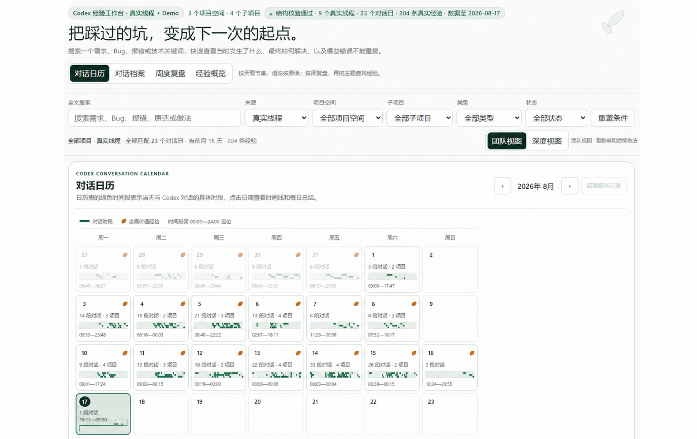
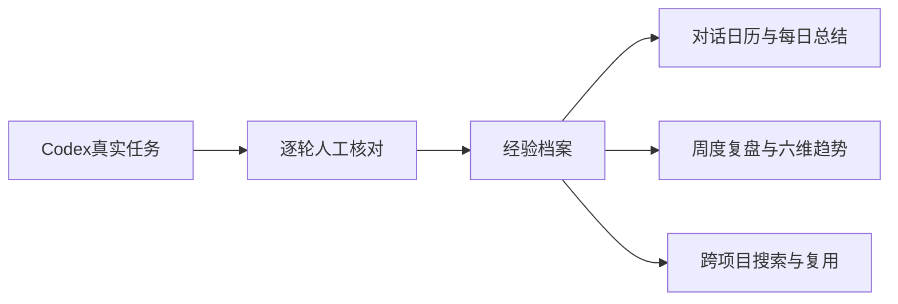

# Codex 经验工作台

> 把踩过的坑，变成下一次的起点。

一个离线、单文件、多项目的 Codex 对话经验工作台。它把分散在长对话里的关键原话、事故、决策、实践和亮点整理成可检索、可复盘、可继续维护的便携知识档案。



预览图来自真实工作台页面，已移除浏览器地址栏、任务 ID、对话原话和技术证据区域。

## 当前快照

| 项目 | 当前值 |
|---|---:|
| 项目空间 | 3 |
| 子项目 | 4 |
| 真实任务 | 9 |
| 唯一真实轮次 | 880 |
| 真实经验 | 204 |
| Demo经验 | 8 |
| 真实对话日 | 23 |
| Integrity errors | 0 |

精确任务清单、校验值和预期警告以 [CURRENT_STATE.md](CURRENT_STATE.md) 为准；运行时事实源始终是页面中的 `window.__knowledgeDataIntegrity`。

## 主要能力

| 入口 | 用途 |
|---|---|
| 对话日历 | 按日期查看交流时段、项目分布和每日总结 |
| 对话档案 | 按任务、日期和轮次连续阅读双方关键原话 |
| 周度复盘 | 聚合每周完成、关键纠正、后续动作、六维图和趋势图 |
| 经验概览 | 用卡片或紧凑列表检索事故、决策、实践和亮点 |
| 多项目空间 | 用“项目空间＋子项目”组织不同项目，并统一搜索和筛选 |
| 团队／深度视图 | 在通俗业务结论与技术证据之间切换，不改变搜索结果 |



## 立即使用

### 从当前文件夹打开

直接双击 [knowledge-review-ui-prototype.html](knowledge-review-ui-prototype.html)。页面通过 `file://` 离线运行，不需要后端、数据库、构建工具或网络连接。

### 从 GitHub 获取

仓库为私有仓库，需要使用具有访问权限的 GitHub 账号：

```bash
git clone https://github.com/666whatcanisay/precipitate.git
cd precipitate
```

克隆完成后双击 `knowledge-review-ui-prototype.html`。GitHub 页面只负责保存和浏览文件，不直接在线运行工作台。

## 项目结构

| 项目空间 | 子项目 | 真实经验 |
|---|---|---:|
| AI 客服系统 | AI-CS | 58 |
| AI 客服系统 | AI-CS-CE | 99 |
| Rainy Studio（雨天放映室） | Character OS | 16 |
| AI Local Creative Studio | X1.0 | 31 |

不同项目共用同一数据模型和检索体验，但项目归属、来源线程和历史事实保持可区分。

## 文件说明

| 文件 | 用途 |
|---|---|
| [knowledge-review-ui-prototype.html](knowledge-review-ui-prototype.html) | 离线经验工作台，也是知识数据唯一事实源 |
| [AGENTS.md](AGENTS.md) | 新 Codex 自动读取的职责、边界与接管规则 |
| [CODEX_WORKFLOW.md](CODEX_WORKFLOW.md) | 逐任务人工沉淀流程、数据接口与验收方法 |
| [CURRENT_STATE.md](CURRENT_STATE.md) | 当前任务、指标、警告、校验值和远端状态快照 |
| [见面语.txt](见面语.txt) | 新窗口接任时可直接复制的提示语 |
| `assets/` | GitHub 首页使用的脱敏预览资源 |

## 复制到 U 盘或新电脑

1. 完整复制或克隆整个文件夹，不要只复制 HTML。
2. 双击 HTML，确认本地页面正常打开。
3. 在 Codex 中把该文件夹作为工作目录打开。
4. 发送：

```text
请先阅读本文件夹的 AGENTS.md、CODEX_WORKFLOW.md 和 CURRENT_STATE.md，然后继续沉淀：codex://threads/这里替换为任务ID
```

新 Codex 应完整读取来源任务、人工分段、逐轮核对、写入 HTML、执行完整性验收并更新当前状态。

## 真实性与隐私

- `threadVerified=true` 只表示内容已与原始 Codex 对话核对，不表示历史运行状态仍然有效。
- 未重新检查当前项目时，记录保持“历史记录”和 `currentProjectVerified=false`。
- Demo 只用于展示交互，不冒充真实项目事实。
- 中断轮次、计划回复和过程回复不得写成已完成结果。
- 本仓库包含真实对话节选和历史技术证据，因此必须保持私有。
- 不得上传数据库、密钥、浏览器登录态、客户隐私、原始对话全文或被沉淀项目源码。

## 维护与同步

日常接入新任务时，默认只更新本地工作台和交接快照，不自动提交或推送 GitHub。只有用户明确要求同步时，Codex 才能在重新执行完整性与敏感信息检查后提交到这个私有仓库。

这不是自动解析系统。逐轮判断、主题分段、事实核验和经验提炼继续由 Codex 人工完成。
